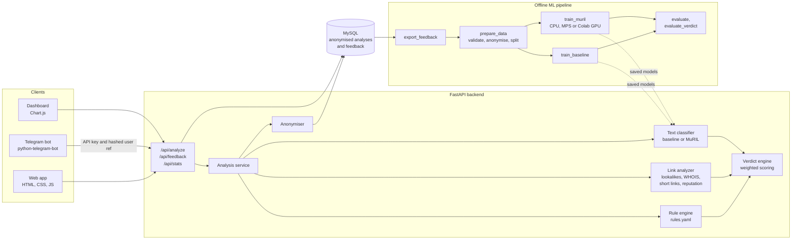
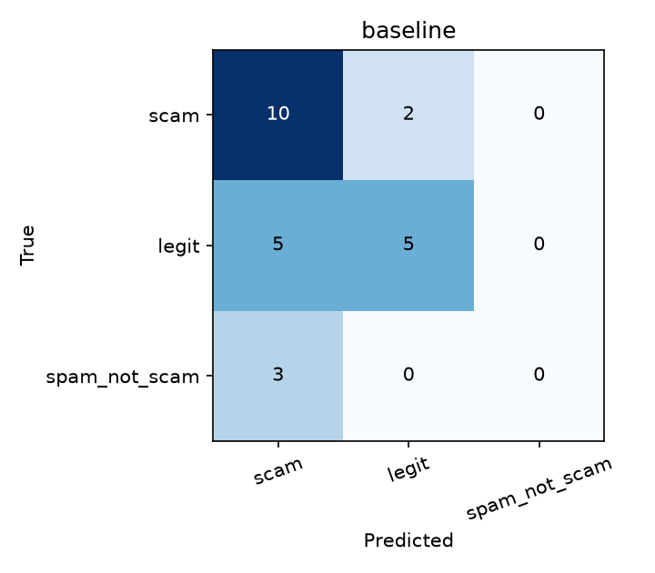
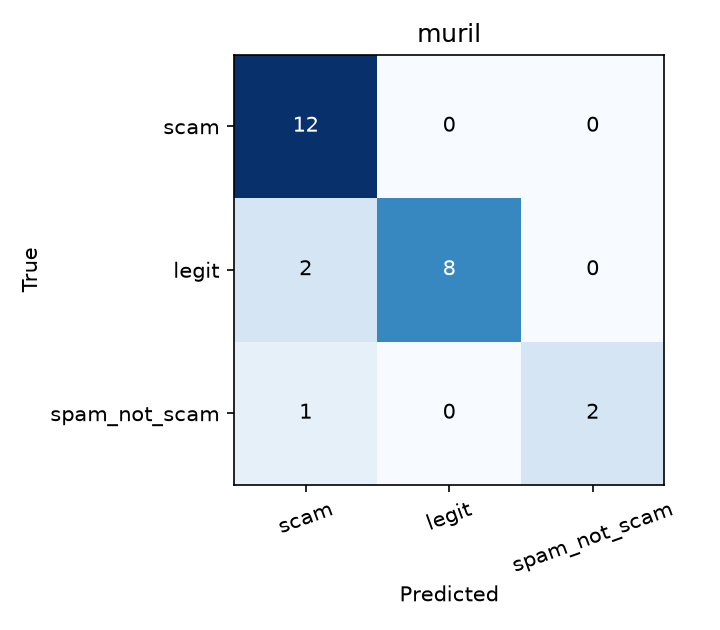
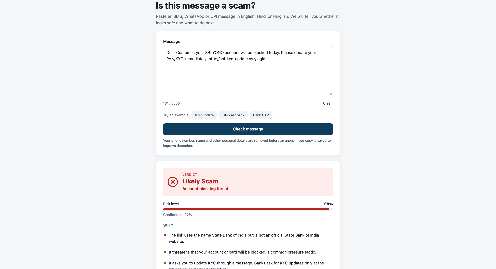
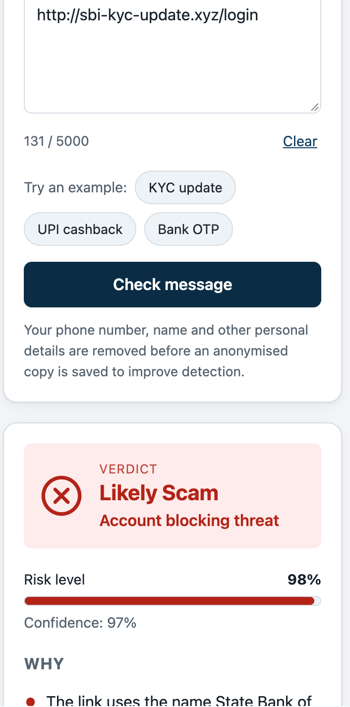
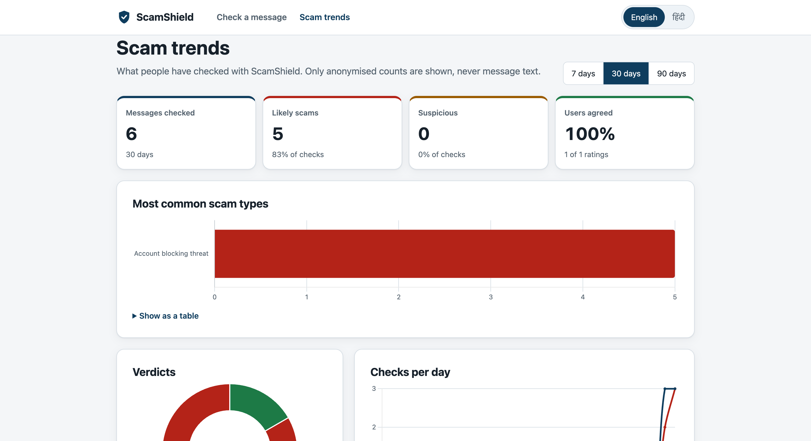
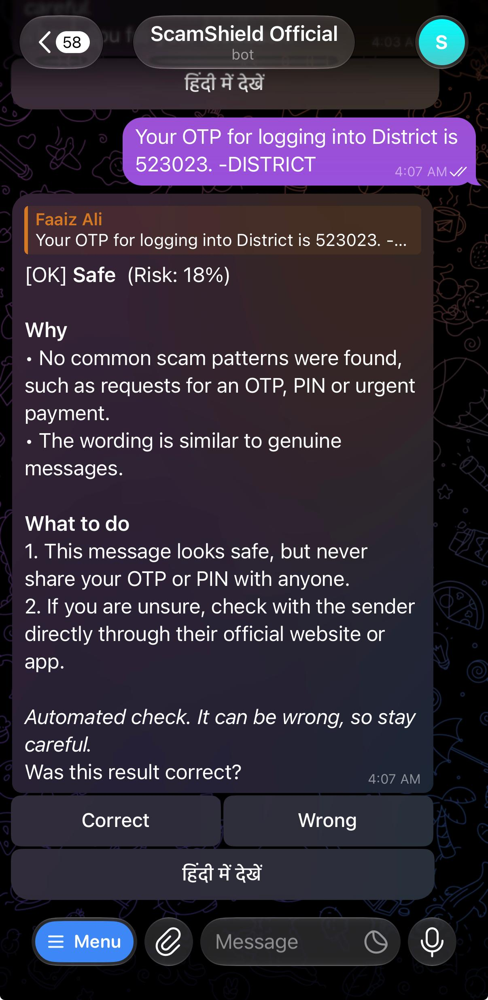

# ScamShield

A multilingual scam message detector for Indian users. Paste or forward an SMS, WhatsApp or
UPI-related message in **English, Hindi or Hinglish** and ScamShield returns a verdict
(**Safe**, **Suspicious** or **Likely Scam**), two or three plain-language reasons, and what to
do next. It is available as a web app and a Telegram bot.

## Problem statement

Fraudsters in India reach people mainly through SMS, WhatsApp and phone calls: fake KYC
updates, "enter your UPI PIN to receive money", electricity disconnection threats, fake job
offers with registration fees, lottery and KBC prizes, courier and customs scams, and police
or CBI "digital arrest" threats. The messages are often in Hindi or Hinglish, written to create
panic, and use links that imitate real banks and government sites.

Most people cannot easily tell a genuine bank OTP from a scam that looks almost the same, and
generic spam filters are built for English and Western scam patterns. ScamShield gives a quick
second opinion in the user's own language, explains *why* a message is risky, and points to the
right next step (never share an OTP, report at cybercrime.gov.in, call the 1930 helpline).

The scale of the problem:

- Citizens lost **Rs 22,845.73 crore** to cyber fraud in 2024, about three times the
  Rs 7,465.18 crore lost in 2023. In the same year, **22.68 lakh** cybercrime complaints were
  registered on the National Cyber Crime Reporting Portal. (Ministry of Home Affairs, written
  answer in the Lok Sabha, 22 July 2025, from Indian Cyber Crime Coordination Centre data;
  [report](https://www.theweek.in/wire-updates/business/2025/07/22/del23-lsq-cyber-fraud.html).)
- The National Crime Records Bureau's *Crime in India 2024* recorded **1,01,928** cybercrime
  cases, up 17.9% from 2023, with **fraud the motive in 72.6%** of them
  ([report](https://www.thequint.com/news/breaking-news/ncrb-2024-cybercrime-rises-overall-crime-drops)).

## Features

- **Three detectors combined into one verdict**
  - **Rule engine**: 30 rules for common Indian scam patterns, working on English,
    Devanagari Hindi and Hinglish, defined in YAML so new rules need no code changes.
  - **Link analyzer**: finds links (with or without `http`), flags lookalike domains of
    Indian banks, payment apps and government sites, suspicious domain endings, IP-address
    links and newly registered domains; expands short links safely; optional Google Safe
    Browsing and VirusTotal checks.
  - **Text classifier**: TF-IDF + logistic regression baseline, and a fine-tuned
    [MuRIL](https://huggingface.co/google/muril-base-cased) model for Indian languages.
- **Explainable results** in English and Hindi: top reasons, most severe first, and
  recommended actions.
- **Low false positives on genuine messages**: genuine bank OTPs that say "do not share",
  "card blocked as per your request" and official links are recognised.
- **Web app**: responsive, light and dark mode, language toggle, feedback buttons.
- **Telegram bot**: forward a message and get the verdict, with Correct / Wrong feedback
  buttons and an English / Hindi toggle.
- **Dashboard** of the most common scam types, verdicts and daily checks (Chart.js).
- **Feedback loop**: user ratings are exported as labelled data for retraining.
- **Privacy by design**: only anonymised text is stored; phone numbers, names, account and
  card numbers, amounts and OTPs are removed first; client identifiers are salted hashes.

## Architecture



### How a verdict is made

1. The **rule engine** normalises the text (Unicode cleanup, removing zero-width characters
   and the Devanagari nukta, case folding) and runs every rule. Each hit has a severity
   between 0 and 1 and a reason in English and Hindi.
2. The **link analyzer** checks every link offline, and when enabled expands known
   shorteners (contacting only the shortener, never the destination), looks up domain age
   and queries reputation services.
3. The **classifier** gives the probability that the message is a scam.
4. The **verdict engine** combines the three. Within each source, signals are merged with a
   noisy-OR, `1 - prod(1 - severity)`, so several weak signs add up. The source scores are
   weighted (rules 0.9, links 0.85, model 0.6) and combined the same way. Missing sources
   (no link, no model) do not dilute the score. With the default weights the model alone can
   raise a message to Suspicious but never to Likely Scam. When every link is official and no
   critical sign is present, the score is halved.
5. The score is compared with two thresholds (0.35 Suspicious, 0.65 Likely Scam), and the top
   three reasons and up to four actions are chosen.

## Tech stack

| Area | Tools |
|---|---|
| Language | Python 3.11+ |
| Backend | FastAPI, Uvicorn, Pydantic |
| Database | MySQL 8 (utf8mb4), SQLAlchemy 2, Alembic |
| Rules | YAML rule definitions, Python `re` |
| Link analysis | tldextract, python-whois, RapidFuzz, httpx |
| Machine learning | scikit-learn, pandas, joblib; PyTorch and Hugging Face Transformers for MuRIL |
| Bot | python-telegram-bot 21+ (async) |
| Frontend | HTML, CSS, vanilla JavaScript (ES modules), Chart.js |
| Testing | pytest, pytest-asyncio, ruff |

## Project structure

```
ScamShield/
  app/
    api/            FastAPI routes, dependencies, error handlers
    core/           settings, database, cache, rate limiter, hashing
    detection/      rules.py + rules.yaml, url_analyzer.py + url_data.yaml,
                    classifier.py, muril_classifier.py, verdict.py,
                    anonymize.py, normalize.py, language.py, preprocessing.py
    models/         SQLAlchemy models
    schemas/        Pydantic request and response models
    services/       analysis pipeline, storage and statistics
    main.py         application factory
  bot/              Telegram bot (client, formatting, handlers, entry point)
  web/              index.html, dashboard.html, static CSS, JS and images
  ml/               data preparation, training, evaluation, feedback export
    colab/          Google Colab notebook for MuRIL training
    models/         trained models (git-ignored)
    results/        evaluation reports
  data/             labeling guide and synthetic seed sample
  migrations/       Alembic migrations
  tests/            pytest suite
```

## Getting started

### Prerequisites

- Python 3.11 or newer
- MySQL 8 (or SQLite for a quick local try-out)

### Install

```bash
python3 -m venv .venv
source .venv/bin/activate
pip install -r requirements.txt
cp .env.example .env
```

Edit `.env`. At minimum set `DATABASE_URL` and a random `HASH_SALT`:

```bash
python -c "import secrets; print(secrets.token_hex(32))"
```

### Database

```bash
mysql -uroot -e "CREATE DATABASE scamshield CHARACTER SET utf8mb4 COLLATE utf8mb4_unicode_ci; CREATE USER 'scamshield'@'localhost' IDENTIFIED BY 'choose-a-password'; GRANT ALL ON scamshield.* TO 'scamshield'@'localhost';"
alembic upgrade head
```

For a quick try-out without MySQL, set `DATABASE_URL=sqlite:///./scamshield.db` and
`DATABASE_AUTO_CREATE=true` instead.

### Run the web app

```bash
uvicorn app.main:app --reload
```

- Checker: http://localhost:8000
- Dashboard: http://localhost:8000/dashboard
- API docs: http://localhost:8000/api/docs (hidden when `ENVIRONMENT=production`)

The API works without a trained model (rules and links only); train the baseline below for
better results.

### Run the Telegram bot

1. Create a bot with [@BotFather](https://t.me/BotFather) and copy the token.
2. In `.env`, set `TELEGRAM_BOT_TOKEN`, `API_BASE_URL` (where the API runs) and a random
   `BOT_API_KEY` (the API uses it to rate limit each Telegram user separately).
3. With the API running:

```bash
python -m bot.main
```

Commands: `/start`, `/help`, `/language`. Forward or paste any message to check it.

## Training the models

### 1. Data

See [data/LABELING_GUIDE.md](data/LABELING_GUIDE.md) for the CSV format
(`id, text, language, label, source, scam_type`), label definitions and privacy rules.
`data/seed_sample.csv` contains 100 **synthetic** messages for development only. Put your
own collected data in `data/raw/` (git-ignored).

```bash
python -m ml.prepare_data --input data/seed_sample.csv data/raw/my_messages.csv
```

This validates every row, anonymises the text, removes duplicates and writes a stratified
train/test split to `data/processed/`.

### 2. Baseline (TF-IDF + logistic regression)

```bash
python -m ml.train_baseline
```

Word and character n-grams (the latter handle Hinglish spelling variation); the
regularisation strength is chosen by cross-validated grid search. Saved to
`ml/models/baseline.joblib`.

### 3. MuRIL

```bash
pip install -r requirements-ml.txt
python -m ml.train_muril --device auto
```

- **CPU**: `--device cpu --batch-size 8 --grad-accum 4 --freeze-layers 6` (freezing the
  lower layers roughly halves training time).
- **Apple Silicon**: `--device mps`.
- **Google Colab GPU**: open [ml/colab/train_muril.ipynb](ml/colab/train_muril.ipynb), choose
  a GPU runtime and run all cells (`--device cuda --fp16 --batch-size 32`).
- **Small datasets** need more optimiser steps:
  `--grad-accum 1 --learning-rate 5e-5 --epochs 25 --patience 6`.

The best checkpoint by validation macro F1 is saved as safetensors to `ml/models/muril/`. To
serve it, set `CLASSIFIER=muril` in `.env`.

### 4. Evaluate

```bash
python -m ml.evaluate            # classifiers on their own
python -m ml.evaluate_verdict    # the complete system, as users see it
```

`ml/results/` then contains per-class precision, recall and F1, confusion matrices, per-language
scores, bootstrap confidence intervals, misclassified examples (git-ignored), and a threshold
sweep for the Likely Scam threshold.

### 5. Feedback loop

User ratings from the web app and bot are stored with each analysis. Export them as labelled
rows, review them, and retrain:

```bash
python -m ml.export_feedback
python -m ml.prepare_data --input data/seed_sample.csv data/raw/feedback_YYYYMMDD.csv
python -m ml.train_baseline
python -m ml.evaluate
```

Ratings become labels as follows: "wrong" with a chosen label gives that label, "correct" on
a Likely Scam verdict gives `scam`, and "correct" on a Safe verdict gives `legit` only with
`--confirmed-safe-as-legit` (the message could also be spam). The majority vote wins and ties
are skipped.

## API

| Method | Path | Description |
|---|---|---|
| `POST` | `/api/analyze` | Analyse a message. Body: `{"text": "...", "language": "en" or "hi"}` |
| `POST` | `/api/feedback` | Rate a verdict. Body: `{"analysis_id": "...", "is_correct": false, "correct_label": "legit"}` |
| `GET` | `/api/stats?days=30&language=en` | Counts by verdict and scam type, feedback accuracy, daily trend |
| `GET` | `/api/health` | Database status and loaded model |

Example:

```bash
curl -s -X POST localhost:8000/api/analyze -H "Content-Type: application/json" \
  -d '{"text": "Aapka SBI account aaj band ho jayega. Turant KYC update karo: http://sbi-yono-kyc.click"}'
```

```json
{
  "analysis_id": "3c9089fe-a629-47a8-a3d1-c9f412d16be5",
  "verdict": "likely_scam",
  "verdict_label": "Likely Scam",
  "risk_score": 0.9723,
  "confidence": 0.9604,
  "scam_type": "account_threat",
  "scam_type_label": "Account blocking threat",
  "reasons": [
    {"code": "BRAND_IMPERSONATION", "source": "link", "severity": 0.8, "text": "The link uses the name State Bank of India but is not an official State Bank of India website."},
    {"code": "ACCOUNT_BLOCK_THREAT", "source": "rule", "severity": 0.7, "text": "It threatens that your account or card will be blocked, a common pressure tactic."},
    {"code": "KYC_UPDATE", "source": "rule", "severity": 0.65, "text": "It asks you to update KYC through a message. Banks ask for KYC updates only at the branch or inside their official app."}
  ],
  "actions": [
    {"code": "DO_NOT_CLICK", "text": "Do not click any link in this message."},
    {"code": "NEVER_SHARE_CREDENTIALS", "text": "Never share your OTP, PIN, CVV or password with anyone, even if they say they are from your bank."},
    {"code": "CONTACT_BANK_OFFICIALLY", "text": "Contact your bank only through the number on its official website or the back of your card."},
    {"code": "REPORT_CYBERCRIME", "text": "Report it at cybercrime.gov.in or call the 1930 helpline. If you have lost money, call 1930 immediately."}
  ],
  "links": [{"domain": "sbi-yono-kyc.click", "is_official": false, "findings": [{"code": "BRAND_IMPERSONATION", "...": "..."}, {"code": "SUSPICIOUS_TLD", "...": "..."}]}],
  "language": "en",
  "detected_language": "hinglish",
  "translations": {"en": {"...": "..."}, "hi": {"...": "..."}}
}
```

Errors always have the shape `{"error": {"code": "...", "message": "...", "details": [...]}}`.
Requests are rate limited per client (HTTP 429 with `Retry-After`).

## Configuration

All settings are environment variables, read from `.env` (see [.env.example](.env.example)).

| Variable | Default | Purpose |
|---|---|---|
| `DATABASE_URL` | MySQL on localhost | SQLAlchemy URL; keep `?charset=utf8mb4` for Hindi |
| `HASH_SALT` | `change-me` | Secret for hashing client identifiers; required in production |
| `CLASSIFIER` | `baseline` | `baseline`, `muril` or `none` |
| `MODEL_DEVICE` | `cpu` | Device for MuRIL inference: `cpu`, `cuda`, `mps`, `auto` |
| `SUSPICIOUS_THRESHOLD`, `SCAM_THRESHOLD` | `0.35`, `0.65` | Verdict thresholds |
| `VERDICT_RULE_WEIGHT`, `VERDICT_URL_WEIGHT`, `VERDICT_ML_WEIGHT` | `0.9`, `0.85`, `0.6` | Signal weights |
| `VERDICT_OFFICIAL_LINK_FACTOR` | `0.5` | Score multiplier when all links are official |
| `URL_NETWORK_CHECKS` | `true` | Short-link expansion, WHOIS and reputation lookups |
| `GOOGLE_SAFE_BROWSING_API_KEY`, `VIRUSTOTAL_API_KEY` | empty | Optional reputation checks |
| `RATE_LIMIT_PER_MINUTE` | `30` | Requests per client per minute |
| `CORS_ORIGINS` | localhost | Allowed browser origins, comma-separated |
| `TRUST_PROXY_HEADERS` | `false` | Use `X-Forwarded-For` (only behind your own proxy) |
| `TELEGRAM_BOT_TOKEN`, `BOT_API_KEY`, `API_BASE_URL` | empty | Telegram bot |

## Evaluation results

> **These figures come from the 100 synthetic messages in `data/seed_sample.csv` (25 of them in
> the test set). They show that the pipeline works end to end. They are not a measure of
> real-world accuracy: the test set is tiny and the confidence intervals are wide.**
> Re-run `python -m ml.prepare_data`, `python -m ml.evaluate` and
> `python -m ml.evaluate_verdict` after adding real labelled messages (see
> [data/LABELING_GUIDE.md](data/LABELING_GUIDE.md)); the full tables are written to
> `ml/results/comparison.md` and `ml/results/verdict_evaluation.md`.

**Dataset (synthetic seed sample)**

| | Scam | Legit | Spam (not scam) | Total |
|---|---|---|---|---|
| English | 25 | 21 | 8 | 54 |
| Hindi | 10 | 8 | 3 | 21 |
| Hinglish | 13 | 9 | 3 | 25 |
| **Total** | **48** | **38** | **14** | **100** |

Split 75 / 25, stratified by label and language.

**Classifiers on the test set (25 messages)**

| Model | Accuracy | Macro F1 (95% CI) | Scam precision | Scam recall | Legit flagged as scam | ms / message |
|---|---|---|---|---|---|---|
| TF-IDF + logistic regression | 0.600 | 0.418 (0.269 to 0.618) | 0.556 | 0.833 | 50.0% | 0.3 |
| MuRIL (fine-tuned) | 0.880 | 0.859 (0.554 to 1.000) | 0.800 | 1.000 | 20.0% | 30.5 |

Timings are on CPU (Apple silicon).

**Macro F1 by language**

| Model | English (14) | Hindi (7) | Hinglish (4) |
|---|---|---|---|
| TF-IDF + logistic regression | 0.775 | 0.148 | 0.500 |
| MuRIL (fine-tuned) | 1.000 | 0.867 | 0.500 |

With 4 to 7 test messages per language, these per-language scores mostly reflect chance.

**Complete system (verdicts)**

Rules, link checks and the classifier together, with link checks offline. Spam and genuine
messages both count as "not a scam".

| Classifier | Likely Scam precision | Likely Scam recall | Non-scams called Likely Scam | Scams flagged (Suspicious or Likely Scam) |
|---|---|---|---|---|
| Rules and links only | 1.000 | 0.750 | 0.0% | 91.7% |
| With baseline | 1.000 | 0.917 | 0.0% | 91.7% |
| With MuRIL | 1.000 | 0.917 | 0.0% | 91.7% |

The classifier mainly lifts borderline scams from Suspicious to Likely Scam. The rules do most
of the work, which is why the complete system scores well even though the baseline classifier
alone is weak on this little data. The cost is false alarms: with a classifier, 15.4% of
non-scams were marked Suspicious, compared with none for rules and links alone.

**Confusion matrices**

| TF-IDF + logistic regression | MuRIL (fine-tuned) |
|---|---|
|  |  |

## Screenshots

| Checker (desktop) | Checker (mobile, Hindi) |
|---|---|
|  |  |

| Dashboard | Telegram bot |
|---|---|
|  |  |

## Privacy and security

- **Stored data**: anonymised message text, verdict, scam type, rule IDs, link domains (not
  full URLs), model probability and feedback. Raw messages, phone numbers, Telegram user IDs
  and IP addresses are never stored; clients are identified by an HMAC-SHA256 hash with a
  secret salt.
- **Link safety**: links are never rendered or opened. Only known URL shorteners are
  contacted, one hop at a time, with HEAD requests, 5-second timeouts and at most 5 redirects;
  every contacted host must resolve to a public IP on port 80 or 443 (SSRF protection).
  VirusTotal is only queried for existing reports; URLs are never submitted.
- **Web**: strict Content Security Policy with no inline scripts or styles, all server text
  inserted with `textContent`, scam links shown as plain text, Chart.js pinned with
  Subresource Integrity.
- **Models**: the fine-tuned MuRIL is stored as safetensors. The baseline is a joblib
  (pickle) file; only load model files you trained yourself.
- **Secrets**: `.env` is git-ignored; the bot never logs its token or message text.

## Testing

```bash
pytest
ruff check .
ruff format --check .
```

The suite covers the rule engine (with false-positive checks on genuine bank messages), the
link analyzer with mocked network calls (including SSRF cases), anonymisation, the verdict
engine, the API with a temporary database, migrations, the bot handlers, the web pages, and
both training pipelines (MuRIL with a tiny local model, skipped if PyTorch is not installed).

## Limitations

- The seed dataset is small and synthetic; real-world accuracy is unknown until the models are
  trained and evaluated on collected messages.
- Rules use negation patterns to avoid flagging genuine "do not share your OTP" messages; a
  scam that includes such a phrase can suppress a rule. The model and link checks partly
  compensate.
- Name anonymisation is heuristic and only catches names after a salutation.
- Language detection is keyword-based; short Hinglish messages may be detected as English.
- Only text is analysed: images, voice notes and QR codes inside images are not.
- WHOIS data for some Indian domains is incomplete, and lookups can be slow.
- The rate limiter and caches are in-memory, so each server process keeps its own state.
- The verdict weights and thresholds are sensible defaults, not tuned on real data.
- MuRIL probabilities can be poorly calibrated after training on little data.

## Future scope

- Collect and label a larger real-world dataset with consenting users and NGOs.
- Calibrate model probabilities (temperature scaling) and tune verdict weights on held-out data.
- Support more Indian languages (Tamil, Telugu, Bengali, Marathi), which MuRIL already covers.
- OCR for screenshots and QR code decoding; speech-to-text for voice notes.
- An Android app with on-device inference (distilled or quantised model) and SMS integration.
- A WhatsApp Business API bot.
- Named-entity recognition for more reliable anonymisation.
- Shared rate limiting and caching (Redis) for multi-process deployments.
- Automatic retraining from reviewed feedback, with model versioning and A/B comparison.
- A community-maintained list of reported scam numbers and domains.

## Getting help

If you have lost money to a scam in India, call the national cyber crime helpline **1930**
immediately or report at [cybercrime.gov.in](https://cybercrime.gov.in).
